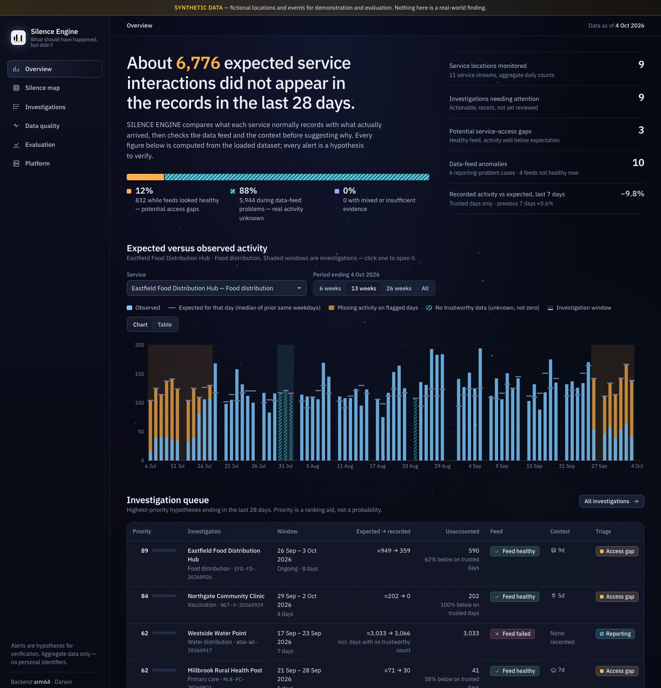
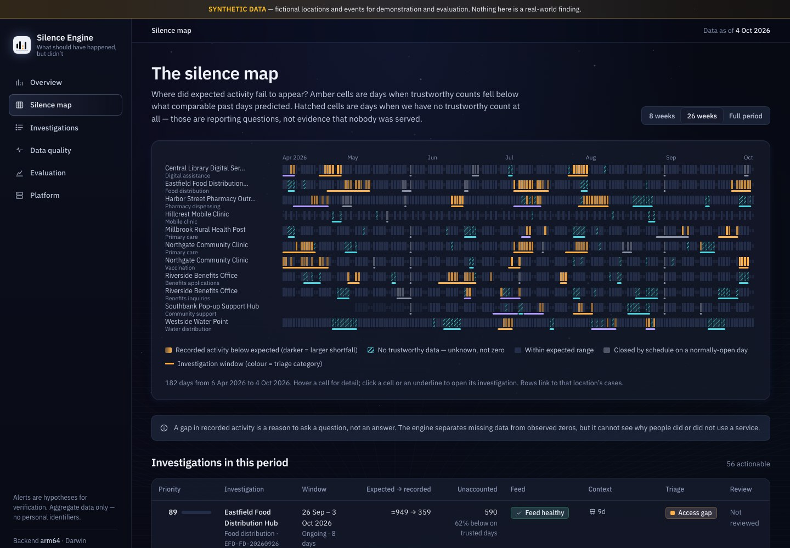
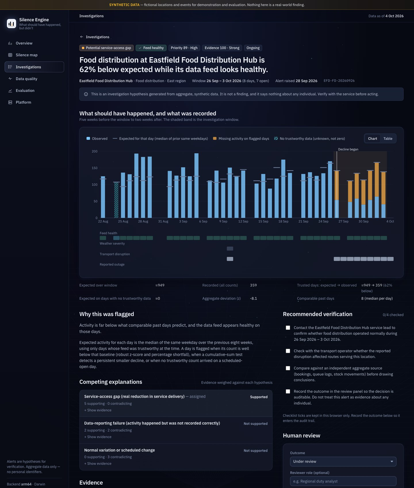
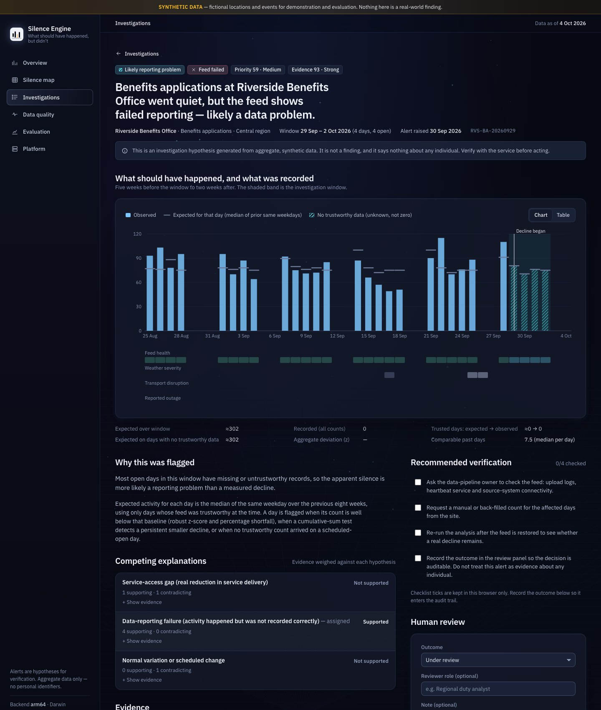

<div align="center">

# SILENCE ENGINE

### Detect what should have happened, but didn't.

An early-warning tool that tells a **real service-access gap** from a **broken data feed**, and says plainly what it cannot conclude.

IBM Z Datathon 2026 · Theme 3, Wildcard: *Beyond the Obvious* · Event code **SSF2026**


-444)


</div>

> **All data in this repository is SYNTHETIC**: fictional locations and events generated with a fixed seed. Nothing here is a real-world finding.



## The idea

Most monitoring looks at events that occurred. Silence Engine also investigates **expected activity that never appeared** at public-service locations (clinics, benefits offices, food hubs, water points), and asks *why*. A falling count is ambiguous: people may face a real barrier, or the data feed may simply have failed. The engine keeps those apart and says when it cannot tell.

| Hypothesis | What it means | Typical evidence |
|---|---|---|
| **Potential service-access gap** | Recorded activity is well below expectation **and** the data feed looks healthy | Trusted counts far below baseline; heartbeat, batches and freshness normal; maybe coinciding weather, transport or an outage |
| **Likely reporting problem** | The silence is plausibly a data artefact; real activity is unknown | Missing records, zeros while the feed was down, stale or flatlined values, incomplete uploads |
| **Expected variation** | Explained by the operating schedule or ordinary variation | Scheduled closure; a shortfall seen often in history |
| **Uncertain: investigate** | Evidence is insufficient or conflicting | A real decline while the feed was also degraded; too little history |

These are **investigation hypotheses for human verification**, never findings. A missing record is not proof that anyone was denied a service.

## See it

**The silence map.** Each row is a service, each cell a day. Amber means trustworthy counts fell below expectation; hatched means we have *no trustworthy count*, which is unknown, not zero.



**Same drop, two different stories.** The case page shows the expected-versus-observed timeline, feed health and context, the evidence for and against each explanation, its limits, and what to verify.

| Healthy feed: potential access gap | Failed feed: likely reporting problem |
|---|---|
|  |  |

## How it works

1. **Validate** aggregate daily records. A blank count is *missing*, never zero; malformed values are kept so they can be reported.
2. **Check the feed** independently of activity: heartbeats, freshness, flatlines, placeholder zeros, duplicates, partial uploads.
3. **Expect**: the median of the same weekday over the previous 8 weeks, using only days that were trustworthy at the time. Strictly causal; no future data.
4. **Measure the gap** with a robust z-score and a CUSUM, and require persistence over days.
5. **Triage** into the four hypotheses with evidence for and against, limitations and verification steps. Humans record a review; every action goes into a hash-chained audit log.

<details>
<summary><b>Architecture and decision-flow diagrams</b></summary>


</details>

## Run it yourself

You need **Python 3.10+**. Node.js is *not* required: the built dashboard is included in `frontend/dist`.

```bash
git clone https://github.com/Yadu080/silence-engine.git
cd silence-engine
./scripts/demo.sh
```

Then open <http://127.0.0.1:8000>. The first run installs the Python packages into `.venv`, generates the synthetic dataset, runs the evaluation (about 15 seconds) and the analysis, and starts the server. Press `Ctrl+C` to stop.

<details>
<summary><b>Windows, or running the steps by hand</b></summary>

The scripts are for macOS and Linux. On Windows (untested) use the same steps manually:

```powershell
python -m venv .venv
.venv\Scripts\pip install -r requirements.txt
cd backend
..\.venv\Scripts\python manage.py init-demo
..\.venv\Scripts\python manage.py serve
```

</details>

### Tests

```bash
./scripts/test.sh
```

90 backend tests (detection, feed failure versus a genuine decline, ground-truth leakage guards, evaluation, API, CSV import, authentication and the optional ML benchmark), then the frontend type-check and production build. Nine tests need scikit-learn and skip cleanly without it; the other 81 need only the standard library and Flask.

### Developing

```bash
./scripts/dev_backend.sh      # Flask on 127.0.0.1:8000
./scripts/dev_frontend.sh     # Vite on 127.0.0.1:5173 with hot reload; proxies /api to the backend
```

Rebuild the dashboard after changing the frontend: `cd frontend && npm ci && npm run build`.

### Command line

```bash
cd backend && ../.venv/bin/python manage.py --help
```

| Command | Purpose |
|---|---|
| `manage.py init-demo [--seed N] [--if-empty]` | Generate SYNTHETIC data, evaluate, analyse |
| `manage.py analyze` | Re-run detection and triage on stored data |
| `manage.py evaluate [--out report.json]` | Re-run the evaluation |
| `manage.py evaluate-ml [--out ml.json]` | *Optional (needs scikit-learn):* train the ML triage model and compare it with the rules |
| `manage.py import-csv FILE [--mode append\|replace]` | Validate and import aggregate records |
| `manage.py fingerprint` | Print dataset and result hashes to compare machines |
| `manage.py verify-audit` | Recompute the audit hash chain |
| `manage.py check-env` | Print verified runtime facts (architecture, versions) |

## IBM Z / LinuxONE

The whole operational pipeline (ingestion, validation, feed-health checks, detection, triage, evaluation, the API and the SQLite audit database) is plain Python plus Flask, so it runs unchanged on Linux on IBM Z (s390x). We ran it on an IBM LinuxONE Community Cloud instance as a non-root user, from a Jupyter notebook, and viewed the dashboard through an SSH tunnel. The **Platform** page reports the architecture it is actually running on, read from the interpreter and the kernel, and never a hard-coded claim.

To repeat that on your own instance, upload the release tarball (built by `./scripts/package_release.sh`) and [notebooks/SilenceEngine_on_LinuxONE.ipynb](notebooks/SilenceEngine_on_LinuxONE.ipynb) to the Jupyter instance and run the notebook top to bottom:

- **Part A**: the engine and the evaluation, inside the kernel, standard library only.
- **Part B**: a virtual environment, the tests, and the dashboard.
- **Part C** (optional): the ML benchmark, using the scikit-learn that ships in the LinuxONE ML image.

Full guide with s390x dependency notes and troubleshooting: [docs/IBM_Z_DEPLOYMENT.md](docs/IBM_Z_DEPLOYMENT.md). Honest limits: no Db2 and no IBM-specific acceleration yet; `database.py` isolates all SQL so Db2 can be added later.

## Results (synthetic test period, seed 42)

Computed by the code in this repository; reproduce with `manage.py init-demo` and compare `results_sha256 = e201d754…`. 55 alertable test events (22 access gaps, 22 reporting failures, 11 ambiguous) and 38 benign events (25 scheduled closures, 13 ordinary dips) over 262 stream-weeks.

| Test period | Naive % drop | Detector only (ablation) | **Silence Engine** |
|---|---|---|---|
| Event recall | 82% (45/55) | 67% (37/55) | **85%** (47/55) |
| Alert precision | 75% (48/64) | 100% (40/40) | **100%** (49/49) |
| Explanation accuracy (given detection) | 47% | 46% | **87%** (41/47) |
| Reporting failures called "access gaps" | 100% | 100% | **0%** |
| False alerts per 100 stream-weeks | 6.1 | 0.0 | **0.0** |
| Benign events left alone | 61% | 97% | **100%** |
| Median detection delay | 1 day | 2 days | 2 days |

With 20% of test-period records deleted at random, false *service-gap* alerts per 100 stream-weeks rise to 22.9 (naive) and 18.7 (ablation) but stay at 0.38 for the engine, because missing days are treated as unknown and routed to data quality.

> **Read these numbers carefully.** They are internal-consistency results on synthetic data whose generator and triage rules were written by the same team. They show that the logic behaves as designed under noise, missing data and delays. They are **not** evidence of real-world accuracy. The 95% intervals are wide (engine recall 74 to 92%). See [docs/LIMITATIONS.md](docs/LIMITATIONS.md).

## Optional ML triage benchmark (scikit-learn)

The detector decides *what* is flagged; triage decides *which kind of silence* it is. An optional random forest learns that second step from synthetic examples and is benchmarked against the hand-written rules. It exists to check that the rules are not leaving easy accuracy on the table. **It is not the production classifier:** it showed no detectable advantage and never changes the cases, scores or numbers elsewhere in the project.

```bash
pip install -r requirements-ml.txt          # not on s390x: PyPI has no s390x wheels; use the LinuxONE ML image's Python
cd backend && python manage.py evaluate-ml  # needs init-demo first
```

| Test period, seed 42 | Rule-based triage | ML (random forest) |
|---|---|---|
| Explanation accuracy given detection | 87% (41/47) | 88% (42/48) |
| Feed failures called access gaps | 0% | 5% (1 of 22) |

Per episode, 42 are right for both methods, 1 only for the rules, 2 only for the model and 5 for neither (exact McNemar p = 1.00): **no detectable difference**, so the explainable rules stay the default. The model was trained only on the synthetic *training* period (42 flagged episodes) and is scored only on the test period (50 episodes). The rule-based verdict and the ground-truth labels are never features, and tests enforce this. It runs only if scikit-learn is installed; otherwise the API and dashboard say so and everything else is unaffected. Details: [METHODOLOGY section 9](docs/METHODOLOGY.md#9-optional-ml-triage-benchmark--ml_triagepy-ml_evaluationpy) and [LIMITATIONS items 19 to 23](docs/LIMITATIONS.md).

## What is in the repository

```
backend/silence_engine/    the core package
  ingest.py                schema and validation (missing ≠ zero ≠ malformed)
  data_generator.py        reproducible SYNTHETIC data, labels kept in a separate file
  data_quality.py          feed-health checks (causal)
  detection.py             baselines, robust z, CUSUM, episodes
  triage.py                hypotheses, evidence, scores, verification steps
  pipeline.py              observations → cases
  evaluation.py            train/test protocol and metrics (with ml_evaluation.py, the only code that reads labels)
  ml_triage.py             optional ML model wrapper (label-free, lazy imports)
  database.py  audit.py    SQLite access and the hash-chained audit trail
  reporting.py  service.py read-side aggregates; write operations and background jobs
  app.py                   Flask REST API and static dashboard
  runtime_info.py          verified runtime and architecture facts
backend/tests/             90 tests
frontend/                  React + TypeScript + Vite + Recharts (built output in frontend/dist)
notebooks/                 SilenceEngine_on_LinuxONE.ipynb
scripts/                   setup, demo, dev, test, package_release, and linuxone/ deployment scripts
docs/                      architecture, methodology, data sources, deployment, limitations, API
```

## Responsible use

Aggregate counts per site and day only, with no personal data. Alerts are hypotheses for human verification, with *uncertain* as a first-class answer. Missing data is never read as zero. Context signals (weather, transport, outages) are described as coinciding, never as causes. A review panel records the human outcome, and there is no automatic or punitive action. See [docs/RESPONSIBLE_AI.md](docs/RESPONSIBLE_AI.md) and [docs/LIMITATIONS.md](docs/LIMITATIONS.md).

## Documentation

- [Architecture](docs/ARCHITECTURE.md): components, data flow, where each part runs
- [Methodology](docs/METHODOLOGY.md): formulas, triage rules, scores, evaluation protocol
- [IBM Z / LinuxONE deployment](docs/IBM_Z_DEPLOYMENT.md): step by step, s390x compatibility, troubleshooting
- [API reference](docs/API.md) · [Data sources](docs/DATA_SOURCES.md) · [Open-source resources](docs/OPEN_SOURCE.md)
- [Limitations](docs/LIMITATIONS.md) · [Responsible AI](docs/RESPONSIBLE_AI.md)

## Tested versions

macOS 26.6 (arm64) with CPython 3.13.9; the core engine is also bit-identical on CPython 3.11.4 and 3.14.7. Flask 3.1.3, Werkzeug 3.1.9, Jinja2 3.1.6, MarkupSafe 3.0.4, gunicorn 23.0.0, pytest 8.4.2, SQLite 3.51. Optional ML benchmark: scikit-learn 1.7.2 / NumPy 2.3.5 and scikit-learn 1.5.1 / NumPy 1.26.4, identical results. Node 20.20.2, React 18.3.1, Recharts 3.8.1, Vite 5.4.11, TypeScript 5.6.3. Exact Python pins are in `requirements-lock.txt`. All project code was written during the datathon window (17 to 18 October 2026) and reuses no code from earlier projects.

---

<div align="center">

### Team CodeWarriorz

**Yadunandan M N** (Leader) · **Sanjay S**

Global Academy of Technology, Bengaluru · IBM Z Datathon 2026 · Event code SSF2026

</div>
