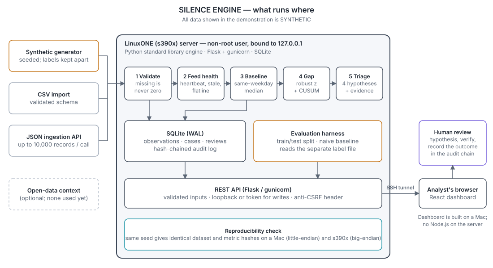
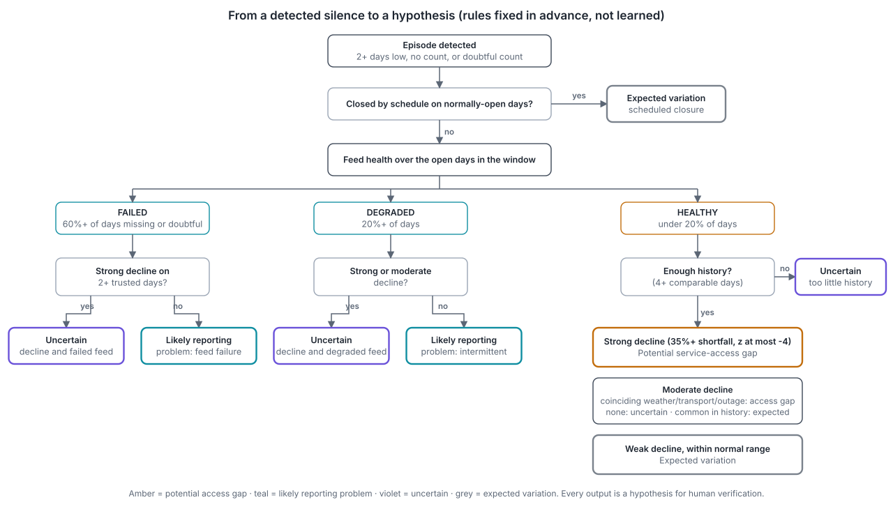

# SILENCE ENGINE: technical documents

*Detect what should have happened, but didn't.* All data is **synthetic**. Back to the [project README](../README.md).

## Architecture: what runs where

The whole operational pipeline (validation, feed-health checks, detection, triage, evaluation, the API and the SQLite audit database) runs on a LinuxONE (s390x) server as a non-root user. The dashboard is reached through an SSH tunnel.

## Solution flowchart: from a detected silence to a hypothesis

The rules are fixed in advance, not learned. Every output is a hypothesis for human verification.

## Documents

| Document | What it covers |
|---|---|
| [ARCHITECTURE.md](ARCHITECTURE.md) | Components, data flow, persistence, concurrency, security |
| [METHODOLOGY.md](METHODOLOGY.md) | Baselines, feed checks, triage rules, scores, evaluation protocol |
| [IBM_Z_DEPLOYMENT.md](IBM_Z_DEPLOYMENT.md) | Running on IBM LinuxONE: s390x compatibility, Jupyter route, troubleshooting |
| [LIMITATIONS.md](LIMITATIONS.md) | What the evidence does and does not show |
| [RESPONSIBLE_AI.md](RESPONSIBLE_AI.md) | Privacy, human review, auditability |
| [DATA_SOURCES.md](DATA_SOURCES.md) | The synthetic generator and the CSV import schema |
| [API.md](API.md) | REST endpoints |
| [OPEN_SOURCE.md](OPEN_SOURCE.md) | Every library, with license and link |
